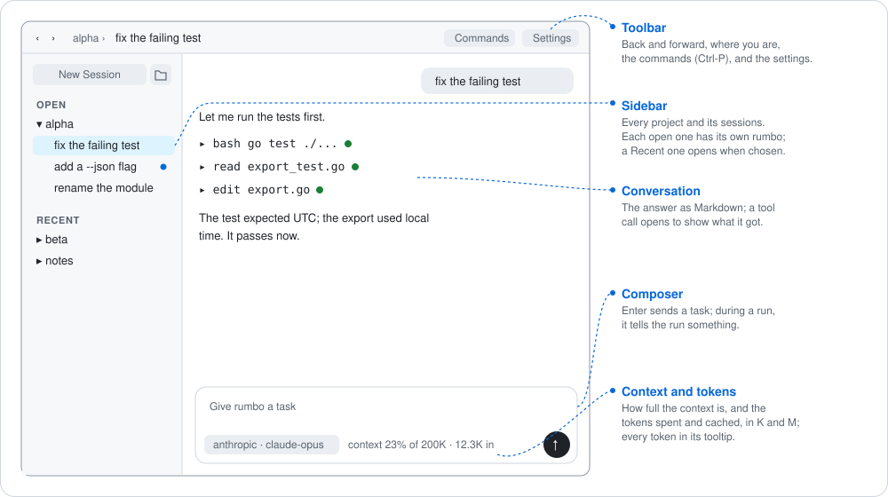

# rumbo-gui

A desktop window for [rumbo](https://github.com/LiasCode/rumbo), the agent
harness: every project and session in one place, each session as a
conversation, and rumbo's settings, without a terminal.



## How it works


- **Each open project has its own `rumbo serve`.** Its runs go on while
  you look at another project or session.
- **Everything is rumbo's.** Sessions, settings, and providers live in
  rumbo, and the settings show them and change them through rumbo, which
  checks a change before it keeps it. The window keeps only
  its preferences (theme, conversation width, the sidebar, the editor, and
  whether to say when a run ends elsewhere), in
  `rumbo-gui/preferences.json` under `~/.config` (or `$XDG_CONFIG_HOME`).
- **The files are yours.** rumbo keeps the conversation, not the files, so
  the Changes panel shows what Git sees changed in the project's folder,
  and Open in Editor hands it to your editor. The window only reads them.
- **Nothing is hard-coded.** Commands, forms, and pickers come from what
  rumbo and the provider describe, so a new function shows up by itself.

## What you can do

- **Work in sessions.** Search them, open one with Ctrl-K or Ctrl-1 … 9,
  rename, branch, compact, export as Markdown, or delete it from its menu.
- **Follow a run.** The model's answer as Markdown, each tool call with
  what it changed in a file, and how long the run took; tell it something
  while it works, or cancel it.
- **Change your mind.** Edit a message, or ask it again, in a branch that
  starts before it; the session you were in stays as it was.
- **Review the work.** The Changes panel shows the diff of the project's
  folder; the Details panel, the session's status and skills.
- **Leave runs working.** Runs go on in other sessions and projects; the
  window tells you when one ends, and marks its session.

## Install

```sh
cargo build --release      # the binary is target/release/rumbo-gui
install -Dm644 rumbo-gui.desktop ~/.local/share/applications/rumbo-gui.desktop
                           # with Exec set to the binary's path if it is not on PATH
```

rumbo must be installed apart: a version later than 0.5, whose
configuration is in `config.yaml` and whose host offers `config`,
`system-set`, `session-set`, and `provider-set`. With an earlier one, the
window still works, without the settings it does not offer. The Recent
projects need a rumbo whose host offers `projects`; without it, the sidebar
lists only the projects open in the window.

## Use

```sh
rumbo-gui [--rumbo PATH] [DIR] [-- FLAGS]
```

| Argument | |
|---|---|
| `DIR` | The first project. Without it, the window starts with none. |
| `FLAGS` | Passed to `rumbo serve`: `-c`, `-s ID`, `-p`, `-m`, `-o name=value`, `-single`, or a first task. |
| `--rumbo PATH` | The rumbo executable, when it is not on `PATH`. |

| Key | Does |
|---|---|
| Enter / Shift-Enter | Send the task, or tell the run in progress something / new line |
| Up, Down | What was asked before, in any session of the project |
| Escape | Give up a provider's function in progress, else cancel the run; leave the settings |
| Ctrl-K, Ctrl-P | Commands, and the project's sessions to show one |
| Ctrl-N | New session |
| Ctrl-1 … Ctrl-9 | The project's sessions, most recently used first |
| Ctrl-B | Show or put away the sidebar |
| Ctrl-F | Search the sessions |
| Ctrl-Shift-G | What changed in the project's folder, as Git sees it |
| Ctrl-Alt-B | The session's details: its status and skills |
| Ctrl-Shift-E | Open the project in your editor |
| Ctrl-O | Open a project |
| Ctrl-, | Settings |

The settings' Keyboard page lists them too.

Closing the window ends every `rumbo serve` it started; a run in progress
is cancelled and recorded.

## As rumbo's front end

rumbo can start the window itself, as it starts its terminal UI. The window
then works only in that rumbo's project, and closes with it.

```sh
rumbo frontend add gui /path/to/rumbo-gui --attached
rumbo -f gui "a task"      # or: rumbo system set frontend gui
```

## Development

[AGENTS.md](AGENTS.md) has the checks every change runs, and
[docs/architecture.md](docs/architecture.md) how the parts fit. Built with
Rust, [GPUI](https://github.com/zed-industries/zed), and
[GPUI Kit](https://gpui-kit.com), which the window is leaving for the
components in `crates/ui`; `cargo run --release -p overview` shows them.
