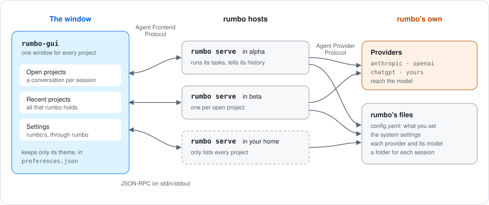

# rumbo-gui

A desktop window for [rumbo](https://github.com/LiasCode/rumbo), the agent
harness: every project and session in one place, each session as a
conversation, and rumbo's settings, without a terminal.


## How it works



- **Each open project has its own `rumbo serve`.** Its runs go on while
  you look at another project or session.
- **Everything is rumbo's.** Sessions, settings, and providers live in
  rumbo, and the settings change them through rumbo. The window keeps only
  its theme, in `rumbo-gui/preferences.json` under `~/.config` (or
  `$XDG_CONFIG_HOME`).
- **Nothing is hard-coded.** Commands, forms, and pickers come from what
  rumbo and the provider describe, so a new function shows up by itself.

## Install

```sh
cargo build --release      # the binary is target/release/rumbo-gui
install -Dm644 rumbo-gui.desktop ~/.local/share/applications/rumbo-gui.desktop
                           # with Exec set to the binary's path if it is not on PATH
```

rumbo 0.4 or later must be installed apart. The Recent projects need a rumbo
whose host offers `projects`; without it, the sidebar lists only the
projects open in the window.

## Use

```sh
rumbo-gui [--rumbo PATH] [DIR] [-- FLAGS]
```

| Argument | |
|---|---|
| `DIR` | The first project. Without it, the window starts with none. |
| `FLAGS` | Passed to `rumbo serve`: `-c`, `-s ID`, `-p`, `-m`, `-o name=value`, `-single`, or a first task. |
| `--rumbo PATH` | The rumbo executable, when it is not on `PATH`. |

| Key | Does |
|---|---|
| Enter / Shift-Enter | Send the task, or tell the run in progress something / new line |
| Up, Down | What was asked before, in any session of the project |
| Escape | Give up a provider's function in progress, else cancel the run; leave the settings |
| Ctrl-P, Ctrl-K | Commands |
| Ctrl-O | Open a project |
| Ctrl-, | Settings |

Closing the window ends every `rumbo serve` it started; a run in progress
is cancelled and recorded.

## As rumbo's front end

rumbo can start the window itself, as it starts its terminal UI. The window
then works only in that rumbo's project, and closes with it.

```sh
rumbo frontend add gui /path/to/rumbo-gui --attached
rumbo -f gui "a task"      # or: rumbo system set frontend gui
```

## Development

[AGENTS.md](AGENTS.md) has the checks every change runs, and
[docs/architecture.md](docs/architecture.md) how the parts fit. Built with
Rust, [GPUI](https://github.com/zed-industries/zed), and
[GPUI Kit](https://gpui-kit.com).
